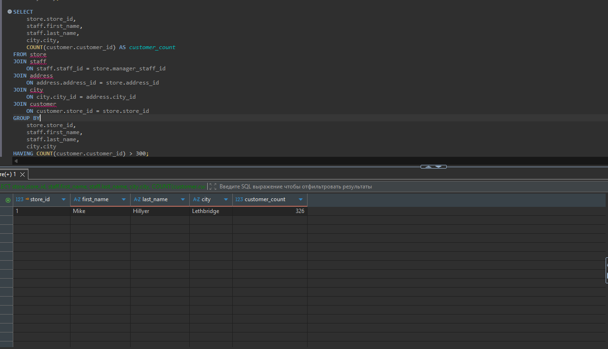
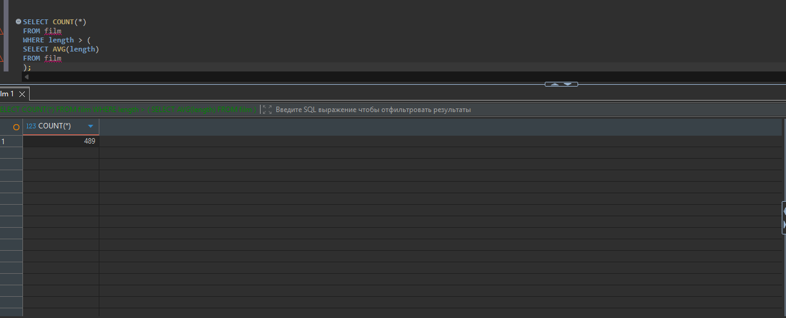
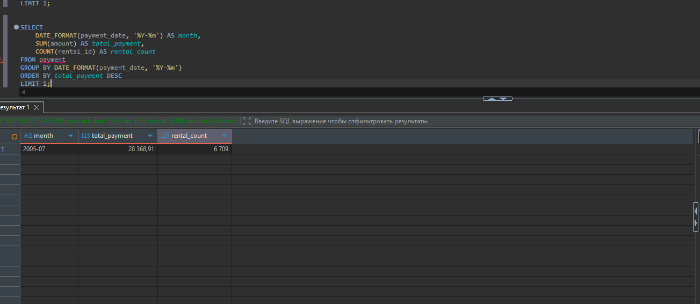
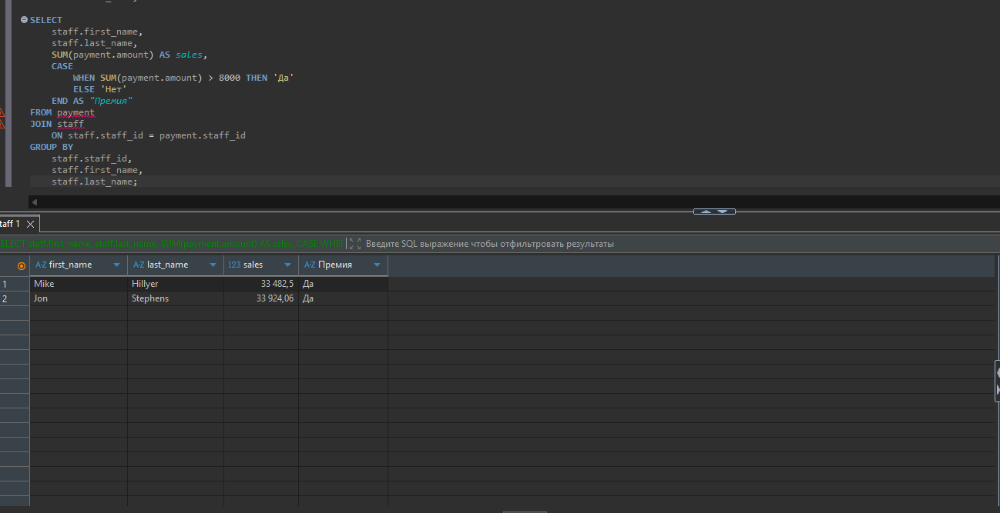
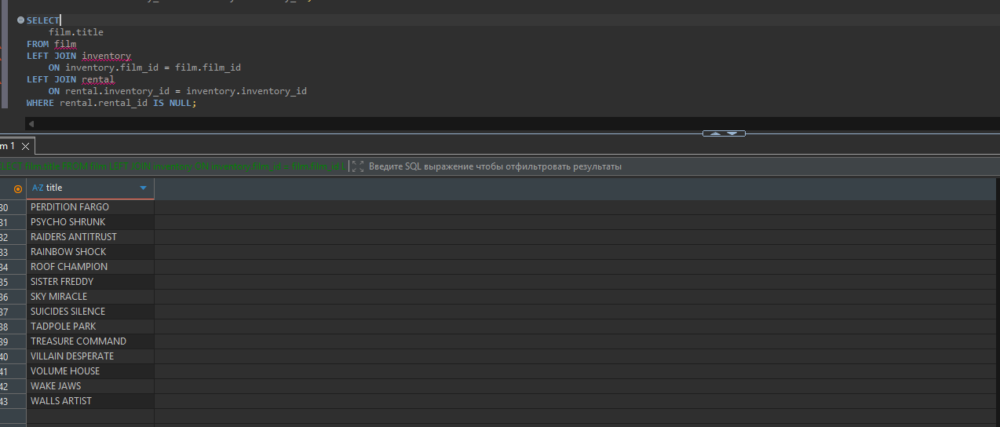

# Домашнее задание к занятию «SQL. Часть 2» — Живова Е.М.


---

### Задание 1


Найти магазин, который обслуживает более 300 клиентов, и вывести имя и фамилию сотрудника, город и количество клиентов.

```sql
SELECT
    store.store_id,
    staff.first_name,
    staff.last_name,
    city.city,
    COUNT(customer.customer_id) AS customer_count
FROM store
JOIN staff
    ON staff.staff_id = store.manager_staff_id
JOIN address
    ON address.address_id = store.address_id
JOIN city
    ON city.city_id = address.city_id
JOIN customer
    ON customer.store_id = store.store_id
GROUP BY
    store.store_id,
    staff.first_name,
    staff.last_name,
    city.city
HAVING COUNT(customer.customer_id) > 300;
```
Результат: магазин №1 обслуживает 326 клиентов.


---

### Задание 2

Посчитать количество фильмов, продолжительность которых выше средней продолжительности всех фильмов.

```sql
SELECT COUNT(*)
FROM film
WHERE length > (
    SELECT AVG(length)
    FROM film
);
```
Результат: 489 фильмов.


---

### Задание 3

Найти месяц с наибольшей общей суммой платежей и указать количество аренд за этот месяц.

```sql
SELECT
    DATE_FORMAT(payment_date, '%Y-%m') AS month,
    SUM(amount) AS total_payment,
    COUNT(rental_id) AS rental_count
FROM payment
GROUP BY DATE_FORMAT(payment_date, '%Y-%m')
ORDER BY total_payment DESC
LIMIT 1;
```

Результат: июль 2005 года (2005-07), количество аренд — 6709


---

### Задание 4*

Для каждого продавца посчитать общую сумму продаж. Если сумма продаж больше 8000, указать «Да» в столбце «Премия», иначе — «Нет».

```sql
SELECT
    staff.first_name,
    staff.last_name,
    SUM(payment.amount) AS sales,
    CASE
        WHEN SUM(payment.amount) > 8000 THEN 'Да'
        ELSE 'Нет'
    END AS "Премия"
FROM payment
JOIN staff
    ON staff.staff_id = payment.staff_id
GROUP BY
    staff.staff_id,
    staff.first_name,
    staff.last_name;
   
 ```

Результат: оба продавца имеют сумму продаж больше 8000, поэтому для обоих указана премия «Да».



---

### Задание 5*

Найти фильмы, которые ни разу не брали в аренду.
```sql
SELECT
    film.title
FROM film
LEFT JOIN inventory
    ON inventory.film_id = film.film_id
LEFT JOIN rental
    ON rental.inventory_id = inventory.inventory_id
WHERE rental.rental_id IS NULL;
```

Результат: найдено 43 фильма, которые ни разу не брали в аренду.

